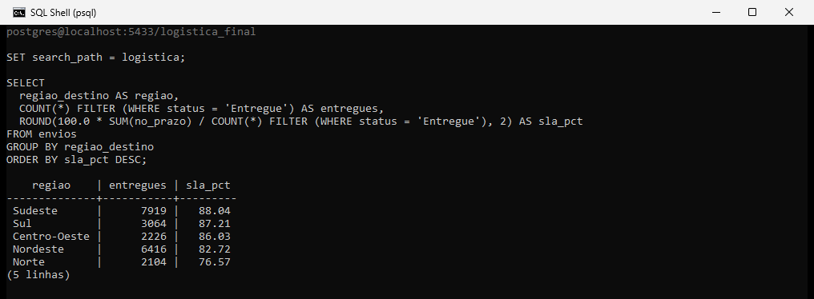
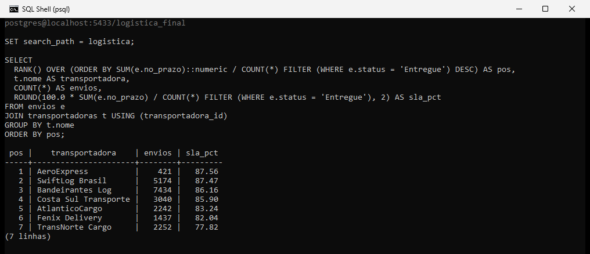

# Performance de Entregas — Transportadora Nacional 2024

Projeto de portfólio para transição de carreira para Análise de Dados.
Setor: **Logística**. Ciclo completo: modelagem SQL → limpeza → análise → dashboard geográfico.

Passo a passo de como o dashboard foi montado (modelo, medidas DAX, gráficos): [`GUIA_POWER_BI.md`](GUIA_POWER_BI.md). Documentação completa do projeto: [`DOCUMENTACAO_PROJETO.md`](DOCUMENTACAO_PROJETO.md).

---

## Pergunta de negócio

**Onde estamos perdendo prazo, quanto isso custa e qual transportadora está puxando o SLA para baixo?**

Cinco perguntas derivadas:

1. Qual o SLA geral e quanto de receita a operação movimenta?
2. Em que estado destino a entrega mais atrasa?
3. Que transportadora está abaixo das demais?
4. Que motivos concentram os atrasos?
5. Vale a pena o custo do modal aéreo?

---

## Stack

| Etapa                | Ferramenta                                  |
| -------------------- | ------------------------------------------- |
| Modelagem e ETL      | PostgreSQL 15 ou superior                   |
| Análise exploratória | SQL (CTE, window functions, PERCENTILE)     |
| Dashboard            | Power BI + Microsoft Excel                  |
| Apresentação         | LinkedIn                                    |

---

## Estrutura do projeto

```
projeto-logistica-entregas/
├── README.md
├── DOCUMENTACAO_PROJETO.md           # documentação completa do projeto (conceitos, dataset, checklist)
├── GUIA_POWER_BI.md                  # passo a passo do dashboard: modelo, medidas DAX, gráficos
├── 01_extracao_dados.md              # como os dados foram gerados
├── 02_sql/
│   ├── 01_criar_tabelas.sql          # DDL + índices + constraints
│   ├── 02_carregar_dados.sql         # COPY dos CSV
│   ├── 03_limpeza.sql                # checagens + colunas derivadas
│   └── 04_analises.sql               # 10 KPIs com CTE/RANK/PERCENTILE
├── 03_dados/
│   ├── transportadoras.csv           # 7 empresas parceiras
│   ├── filiais.csv                   # 15 CDs de origem
│   └── envios.csv                    # 22.000 envios em 2024
├── 04_dashboard_entregas.xlsx        # dashboard executivo
├── 05_post_linkedin.md               # texto pronto pra postar
└── 06_prints/                        # prints das consultas no psql
    ├── print_sql_sla_regiao.png              # SLA por região de destino
    └── print_sql_ranking_transportadoras.png # ranking de transportadoras (RANK)
```

---

## Como reproduzir

Precisa de PostgreSQL 15 ou superior e do `psql` no PATH. Os comandos abaixo rodam num terminal bash (Git Bash no Windows), sempre a partir da raiz do repositório. O `\copy` do `02_carregar_dados.sql` usa caminho relativo (`03_dados/...`), então rodar de outra pasta faz a carga falhar com arquivo não encontrado. Se o servidor não estiver na porta 5432, acrescente `-p` com a porta.

```bash
export PGCLIENTENCODING=UTF8
P="psql -h localhost -U postgres"

$P -d postgres -c "CREATE DATABASE logistica_db ENCODING 'UTF8' TEMPLATE template0"

$P -d logistica_db -v ON_ERROR_STOP=1 -f 02_sql/01_criar_tabelas.sql
$P -d logistica_db -v ON_ERROR_STOP=1 -f 02_sql/02_carregar_dados.sql
$P -d logistica_db -v ON_ERROR_STOP=1 -f 02_sql/03_limpeza.sql
$P -d logistica_db -v ON_ERROR_STOP=1 -f 02_sql/04_analises.sql
```

A carga deve mostrar 7 transportadoras, 15 filiais e 22.000 envios. No primeiro KPI do `04_analises.sql`, o SLA sai 85,03% (18.477 entregas no prazo em 21.729 entregues).

O `02_carregar_dados.sql` não pode ser rodado duas vezes seguidas: a segunda execução falha por chave primária duplicada. Para recarregar, rode antes o `01_criar_tabelas.sql`, que recria o schema. O `03_limpeza.sql` e o `04_analises.sql` podem ser repetidos à vontade. O `04_dashboard_entregas.xlsx` serve para conferir os KPIs, e o `GUIA_POWER_BI.md` explica como montar o dashboard.

---

## Consultas em execução

SLA por região de destino. O Norte fica em 76,57%, contra 88,04% do Sudeste:



Ranking de transportadoras por SLA, com `RANK()`. A TransNorte Cargo está 9,74 pontos atrás da líder:



---

## Modelo de dados

Estrela simplificada com 1 fato + 2 dimensões:

```
transportadoras (7 linhas)  ─┐
                             ├──► envios (22.000 linhas — fato)
filiais (15 linhas)  ────────┘
```

---

## Principais achados

| KPI                                        | Valor           |
| ------------------------------------------ | --------------- |
| Envios totais                              | 22.000          |
| Entregues                                  | 21.729          |
| SLA geral                                  | 85,03%          |
| Receita frete                              | R$ 1,04 milhão  |
| Tempo médio de entrega                     | 4,4 dias        |
| Ticket médio de frete                      | R$ 47,14        |
| Melhor SLA (transportadora)                | AeroExpress 87,6% |
| Pior SLA (transportadora)                  | TransNorte Cargo 77,8% |
| Pior SLA (região)                          | Norte 76,6%     |
| Melhor SLA (região)                        | Sudeste 88,0%   |
| Modal mais caro                            | Aéreo R$ 124    |
| Modal mais barato                          | Rodoviário R$ 38 |
| Motivos de atraso                          | 7 motivos, de 13,6% a 15,4% cada |

---

## Como ler os números

O SLA é o percentual de entregas dentro do prazo calculado sobre os 21.729 envios entregues. Sobre os 22.000 envios o resultado seria 83,99%, porque devolvidos e extraviados entrariam no denominador. Para comparar data de entrega com data prometida, o script converte os dois campos para data (`::date`), já que a entrega tem hora e a promessa não.

Por região, o Norte tem cerca de 2 vezes a taxa de atraso do Sudeste (23,43% contra 11,96%) e o Nordeste fica em 82,72%. O volume de novembro é 45% maior e o de dezembro 59% maior que a média mensal. Novembro é o pior mês do ano, com 82,84% de SLA, e dezembro (83,68%) segue abaixo da média anual. O modal aéreo é 9,6% do volume, entrega em média em 2,4 dias contra 4,6 do rodoviário e tem frete médio de R$ 124, contra R$ 38.

Os sete motivos de atraso ficam entre 13,6% e 15,4% das ocorrências. Falha na roteirização lidera com 500 casos, contra 472 de cliente ausente, uma diferença pequena demais para apontar um motivo principal.

---

## Sobre os dados

A base é sintética: gerada em Python, com parâmetros inspirados em indicadores públicos de transportadoras brasileiras (ANTT, ILOS 2023-2024). Nenhum dado vem de operação real. O pico de novembro e dezembro foi uma premissa do gerador, então ele mostra que o SQL e o dashboard capturam a sazonalidade programada, não um achado sobre uma operação de verdade. O mesmo vale para as diferenças entre regiões e transportadoras, que também foram parametrizadas. Para usar com dados reais, basta carregar CSVs com as mesmas colunas.

---

## Autor

**Vitor França** — engcivil.vitorfranca@gmail.com
Em transição para Análise de Dados.
